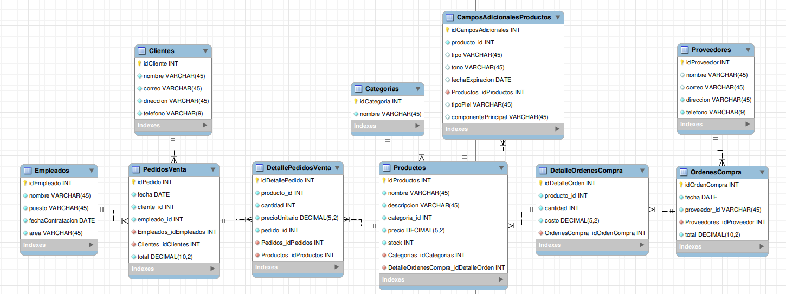

# Tienda de cosméticos

Proyecto de práctica en MySQL para diseñar y consultar la base de datos de una tienda de cosméticos.

## Archivos

- **`DDL.sql`**: crea la base de datos `tienda_cosmeticos` y sus tablas, claves primarias y relaciones.
- **`DML.sql`**: inserta datos de ejemplo para clientes, empleados, productos, proveedores, ventas y compras.
- **`DQL.sql`**: contiene consultas de ejemplo para listar productos, consultar detalles de ventas y calcular compras por cliente.
- **`ERUML.mwb` / `ERUML.png`**: modelo entidad-relación editable y su imagen de referencia.

## Desarrollo y ejecución

El esquema se plantea en el modelo entidad-relación y se implementa en `DDL.sql`. Después se cargan los datos de prueba con `DML.sql` y se prueban consultas de lectura en `DQL.sql`. Para ejecutarlo, abre los archivos en MySQL Workbench y ejecútalos en ese orden. `DML.sql` está pensado para cargarse una sola vez en la base de datos para evitar insertar de nuevo los mismos identificadores.

## Diagrama

